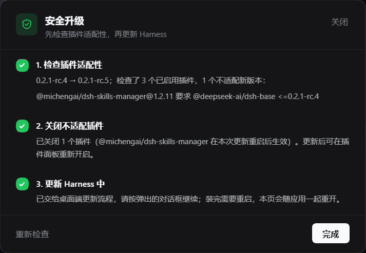
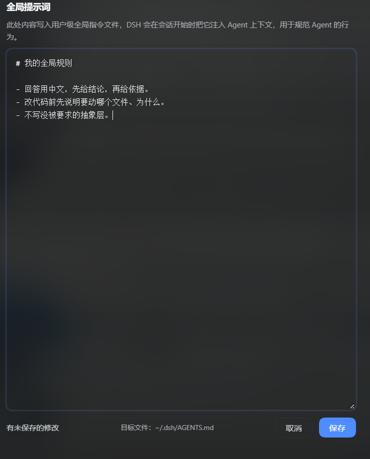

[简体中文](README.md) · [**English**](README.en.md)

# my-dsh-plugins

Personal collection of plugins for **[DeepSeek Harness](https://github.com/deepseek-ai/dsh)** — one repository, one subdirectory per plugin.

Each subdirectory is a self-contained DSH bundle: its own `package.json`, patch file, README, and (where relevant) client half.

| Plugin | What it does | |
| --- | --- | --- |
| [`dsh-safe-upgrade`](./dsh-safe-upgrade) | Checks every enabled plugin against the next harness release **before** updating, and turns off the ones that release would refuse to load. Adds a 安全升级 entry in the sidebar footer. |  |
| [`dsh-global-prompt`](./dsh-global-prompt) | A Settings section that edits the user-level `AGENTS.md` injected into every agent session. |  |

## Installing a plugin from here

DeepSeek Harness profiles are pnpm projects under `%USERPROFILE%\.dsh\profiles\<name>\`. A plugin from this repository is installed as a **linked dependency**, so edits take effect without republishing:

1. Clone the repository (into the plugins directory, so the profile's link path matches):

   ```powershell
   git clone https://github.com/Y-King666/my-dsh-plugins.git C:\Users\<you>\.dsh\plugins\my-dsh-plugins
   ```

2. In `%USERPROFILE%\.dsh\profiles\<profile>\package.json`, add the subdirectory as a link dependency **and** list it as a bundle:

   ```jsonc
   {
     "dependencies": {
       "dsh-safe-upgrade": "link:C:/Users/<you>/.dsh/plugins/my-dsh-plugins/dsh-safe-upgrade"
     },
     "dsh": {
       "profile": {
         "bundles": ["…", "dsh-safe-upgrade"]
       }
     }
   }
   ```

3. Install and restart:

   ```powershell
   cd $env:USERPROFILE\.dsh\profiles\<profile>
   pnpm install
   ```

The desktop app's built-in plugin manager (or the `plugin_manager` tool inside DSH) can also add a linked spec and toggle the bundle for you.

## Note on upgrades

DSH loads a profile's bundle layers through a compatibility gate: a bundle whose declared `@deepseek-ai/dsh*` requirements do not accept the running version is skipped as a whole. That is why plugins can appear to vanish after a harness update — see [`dsh-safe-upgrade`](./dsh-safe-upgrade), which exists to catch exactly that before the update instead of after.

## License

MIT © 2026 Y-King666
