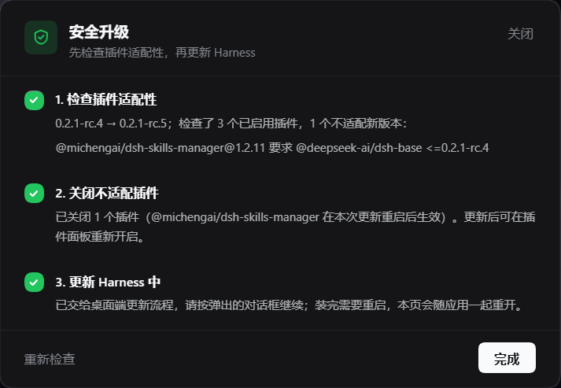
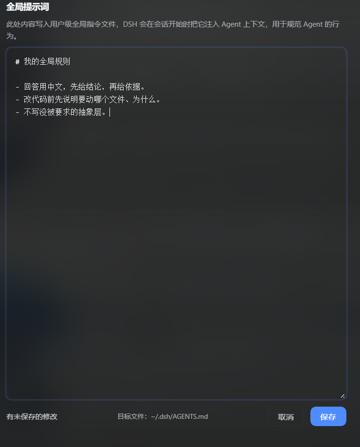

[**简体中文**](README.md) · [English](README.en.md)

# my-dsh-plugins

个人 **[DeepSeek Harness](https://github.com/deepseek-ai/dsh)** 插件合集——一个仓库，每个插件一个子目录。

每个子目录都是完整可安装的 DSH bundle：独立的 `package.json`、补丁文件、README，需要时还带客户端那一半。

| 插件 | 作用 | |
| --- | --- | --- |
| [`dsh-safe-upgrade`](./dsh-safe-upgrade) | 在**更新 Harness 之前**，把每个已启用的插件与新版本逐个核对，把新版本会拒绝加载的插件先关掉。侧栏底部加一个「安全升级」入口。 |  |
| [`dsh-global-prompt`](./dsh-global-prompt) | 设置页里的一个分区，用来编辑注入每个 agent 会话的用户级 `AGENTS.md`。 |  |

## 安装本仓库的插件

DeepSeek Harness 的 profile 本质是 `%USERPROFILE%\.dsh\profiles\<name>\` 下的 pnpm 工程。本仓库的插件以**链接依赖**的方式安装，改代码不用重新发布：

1. 克隆仓库（放在插件目录里，和 profile 的链接路径对得上）：

   ```powershell
   git clone https://github.com/Y-King666/my-dsh-plugins.git C:\Users\<you>\.dsh\plugins\my-dsh-plugins
   ```

2. 在 `%USERPROFILE%\.dsh\profiles\<profile>\package.json` 里，把子目录加为链接依赖，**并**登记成一个 bundle：

   ```jsonc
   {
     "dependencies": {
       "dsh-safe-upgrade": "link:C:/Users/<you>/.dsh/plugins/my-dsh-plugins/dsh-safe-upgrade"
     },
     "dsh": {
       "profile": {
         "bundles": ["…", "dsh-safe-upgrade"]
       }
     }
   }
   ```

3. 安装并重启：

   ```powershell
   cd $env:USERPROFILE\.dsh\profiles\<profile>
   pnpm install
   ```

桌面端的插件管理器（或 DSH 里的 `plugin_manager` 工具）也能替你加链接依赖、开关 bundle。

## 关于升级

DSH 装载 profile 的 bundle 层时会过一道兼容闸门：声明了不满足当前运行版本的 `@deepseek-ai/dsh*` 范围的 bundle，会被**整层跳过**。这就是为什么 Harness 一升级，插件看起来会"凭空消失"——[`dsh-safe-upgrade`](./dsh-safe-upgrade) 存在的意义，就是把这件事从"升级之后"挪到"升级之前"。

## 许可

MIT © 2026 Y-King666
