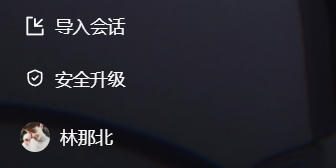
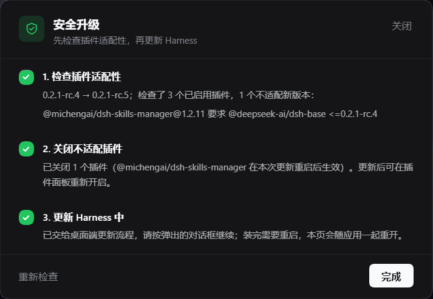

[简体中文](README.md) · [**English**](README.en.md)

# dsh-safe-upgrade

An upgrade entry for **DeepSeek Harness desktop** that checks your plugins *before* the harness updates itself, and turns off the ones the next release would refuse to load.

Harness upgrades are where DSH breaks loudest: a release raises the `@deepseek-ai/dsh*` versions a plugin may run against, and every plugin still declaring the old range fails the host's compatibility gate. The host does not crash — it silently skips the whole bundle layer (or disables the row) and prints the reason to a stderr nobody sees. What you get is a UI with missing panels and plugins that cannot be enabled or opened.

This plugin puts that check in front of the upgrade instead of behind it.





## What it does

A **安全升级** (safe upgrade) entry appears in the sidebar footer, above the account row — but only while the official feed carries a version newer than the build you are running. Already current? No button at all.

Clicking it opens a three-step dialog:

| Step | What happens | Result |
| --- | --- | --- |
| 1. 检查插件适配性 | Reads the official feed, then evaluates every **enabled** plugin against the next version with the same rule the host uses | green check, plus the exact unmet peer when something is off |
| 2. 关闭不适配插件 | Calls the plugin manager's `setBundleEnabled(name, false)` for each incompatible bundle | green check; dependencies and configuration are kept, so you can re-enable them later |
| 3. 更新 Harness 中 | Hands over to the desktop shell's own updater via `window.dshDesktop.updates.open()` | "handed off to the desktop updater" — not a fake success |

Every step shows a spinner while running, a green circle with a check when done, and a red circle with a cross (plus the reason) when it fails. **重新检查** re-runs the whole check without closing the dialog.

## How compatibility is decided

The rule is copied from the host's `evaluatePluginCompatibility`, not invented:

- a plugin's own `engines.dsh` range decides alone, and its peers are then ignored; otherwise
- **every** `@deepseek-ai/dsh` and `@deepseek-ai/dsh-*` peer must accept the target version, with prereleases participating (`includePrerelease: true`);
- `workspace:^`, `workspace:~`, `workspace:*` peers mean "this runtime", as they do on the host.

`core.js` carries a dependency-free semver evaluator covering `^`, `~`, `>=`, `<=`, `>`, `<`, `=`, `x`/`*` wildcards, hyphen-free comparator sets and `||` alternatives.

## Where the target version comes from

The desktop shell's own updater feed — `app-update.yml` names it as a generic provider, e.g. `https://download.deepseek.com/dsh-desk/feeds/win-x64/nightly.yml`. The host caches the answer for five minutes; nothing else is contacted and no telemetry is collected.

The running version is read from the application archive (`resources/app.asar` → `dsh/package.json`), falling back to the version the profile's in-box `@deepseek-ai/dsh-base` bundle declares.

## Limits worth knowing

- **Step 3 cannot be owned by a web plugin.** Downloading and installing happen in the Electron main process (`electron-updater`), and installation restarts the application, so the page cannot watch progress or finish it. The dialog says so instead of pretending.
- On a build whose window does not expose `window.dshDesktop.updates`, step 3 tells you to use the sidebar's own **新版本** button.
- Disabling a bundle is a `restart-required` change; the upgrade's restart applies it, and the disabled plugins stay installed and re-enableable.

## Install

This plugin is developed in [`my-dsh-plugins`](../README.md) and is not on npm. Link it into a profile:

```powershell
# 1. clone
git clone https://github.com/Y-King666/my-dsh-plugins.git C:\Users\<you>\.dsh\plugins\my-dsh-plugins

# 2. add it as a linked dependency of the desktop profile
#    (edit %USERPROFILE%\.dsh\profiles\desktop\package.json)
"dsh-safe-upgrade": "link:C:/Users/<you>/.dsh/plugins/my-dsh-plugins/dsh-safe-upgrade"
```

then add `dsh-safe-upgrade` to `dsh.profile.bundles` in the same file and run `pnpm install` in the profile directory (the plugin manager, the market, or `dsh plugin add` can also do this for you). Restart the app.

## Files

| File | Role |
| --- | --- |
| `index.js` | host half: `GET /safe-upgrade/api/status`, `GET …/plan`, `POST …/disable` |
| `core.js` | semver, feed parsing, runtime version probe, compatibility evaluation |
| `client.js` | client half: the sidebar entry and the three-step dialog |
| `cordis.patch.yml` | inserts the `safe-upgrade` row |

## License

MIT © 2026 Y-King666
