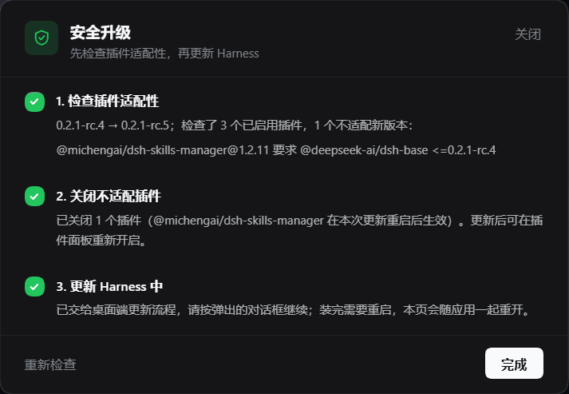

[**简体中文**](README.md) · [English](README.en.md)

# dsh-safe-upgrade

给 **DeepSeek Harness 桌面端**的升级入口：在 Harness 自己更新**之前**先把插件核一遍，把新版本会拒绝加载的插件关掉。

Harness 升级是 DSH 炸得最响的地方：一个版本抬高了插件允许运行的 `@deepseek-ai/dsh*` 版本，所有还声明旧范围的插件就过不了宿主那道兼容闸门。宿主不会崩——它会静默跳过整个 bundle 层（或禁用那一行），把原因打印到没人看得见的 stderr。你看到的结果是：面板不见了、插件打不开、启用按钮点了没反应。

这个插件把这道检查从"升级之后"挪到了"升级之前"。




## 它做什么

侧栏底部、账号行上方会出现一个 **安全升级** 入口——**只有官方 feed 里的版本比你正在跑的新时才出现**。已经是最新？按钮根本不显示。

点开是三步弹窗：

| 步骤 | 发生什么 | 结果 |
| --- | --- | --- |
| 1. 检查插件适配性 | 读取官方 feed，然后用与宿主相同的规则，把每个**已启用**的插件对目标版本评估一遍 | 绿圆+√；有问题时直接列出没被满足的那条 peer |
| 2. 关闭不适配插件 | 对每个不适配的 bundle 调用插件管理器的 `setBundleEnabled(name, false)` | 绿圆+√；依赖与配置都保留，之后可以再打开 |
| 3. 更新 Harness 中 | 通过 `window.dshDesktop.updates.open()` 交给桌面端自带的更新器 | 显示"已交给桌面端更新流程"——不伪造成功 |

每一步运行时有转圈，完成变绿圆+√，失败变红圆+×并附原因。**重新检查**可以在不关闭弹窗的情况下把整套检查重跑一遍。

## 适配性怎么判定

规则照抄宿主的 `evaluatePluginCompatibility`，不是我自己发明的：

- 插件自己的 `engines.dsh` 范围说了算，此时忽略它的 peer；没有才往下走
- **每一个** `@deepseek-ai/dsh` 与 `@deepseek-ai/dsh-*` peer 都必须接受目标版本，预发布版本参与比较（`includePrerelease: true`）
- `workspace:^`、`workspace:~`、`workspace:*` 表示"跟随当前运行时"，与宿主一致

`core.js` 里是一个零依赖的 semver 求值器，覆盖 `^`、`~`、`>=`、`<=`、`>`、`<`、`=`、`x`/`*` 通配、无连字符的比较器集合，以及 `||` 备选。

## 目标版本从哪里来

桌面端自己的更新源——`app-update.yml` 里写的是 generic provider，例如 `https://download.deepseek.com/dsh-desk/feeds/win-x64/nightly.yml`。宿主缓存五分钟；除它之外不请求任何地址，也不收集遥测。

当前运行版本从应用归档里读（`resources/app.asar` → `dsh/package.json`），读不到时退回到 profile 里内置的 `@deepseek-ai/dsh-base` bundle 声明的版本。

## 需要知道的限制

- **第 3 步不可能由网页插件自己完成。** 下载与安装发生在 Electron 主进程（`electron-updater`），装完应用会重启，页面看不到进度也等不到结果。所以弹窗如实说明，而不是假装打勾。
- 在窗口没有暴露 `window.dshDesktop.updates` 的构建上，第 3 步会提示你改用侧栏自带的 **新版本** 按钮。
- 关闭 bundle 属于 `restart-required` 变更，由这次升级的重启生效；被关掉的插件仍然装着，随时可以重新启用。

## 安装

本插件开发于 [`my-dsh-plugins`](../README.md)，未发布到 npm。用链接依赖接进 profile：

```powershell
# 1. 克隆
git clone https://github.com/Y-King666/my-dsh-plugins.git C:\Users\<you>\.dsh\plugins\my-dsh-plugins

# 2. 作为链接依赖加进 desktop profile
#    （编辑 %USERPROFILE%\.dsh\profiles\desktop\package.json）
"dsh-safe-upgrade": "link:C:/Users/<you>/.dsh/plugins/my-dsh-plugins/dsh-safe-upgrade"
```

然后在同一个文件里把 `dsh-safe-upgrade` 加进 `dsh.profile.bundles`，在 profile 目录跑一次 `pnpm install`（插件管理器、市场、`dsh plugin add` 也能替你完成），再重启应用。

## 文件

| 文件 | 作用 |
| --- | --- |
| `index.js` | host 一半：`GET /safe-upgrade/api/status`、`GET …/plan`、`POST …/disable` |
| `core.js` | semver、feed 解析、运行时版本探测、适配性评估 |
| `client.js` | client 一半：侧栏入口与三步弹窗 |
| `cordis.patch.yml` | 插入 `safe-upgrade` 这一行 |

## 许可

MIT © 2026 Y-King666
